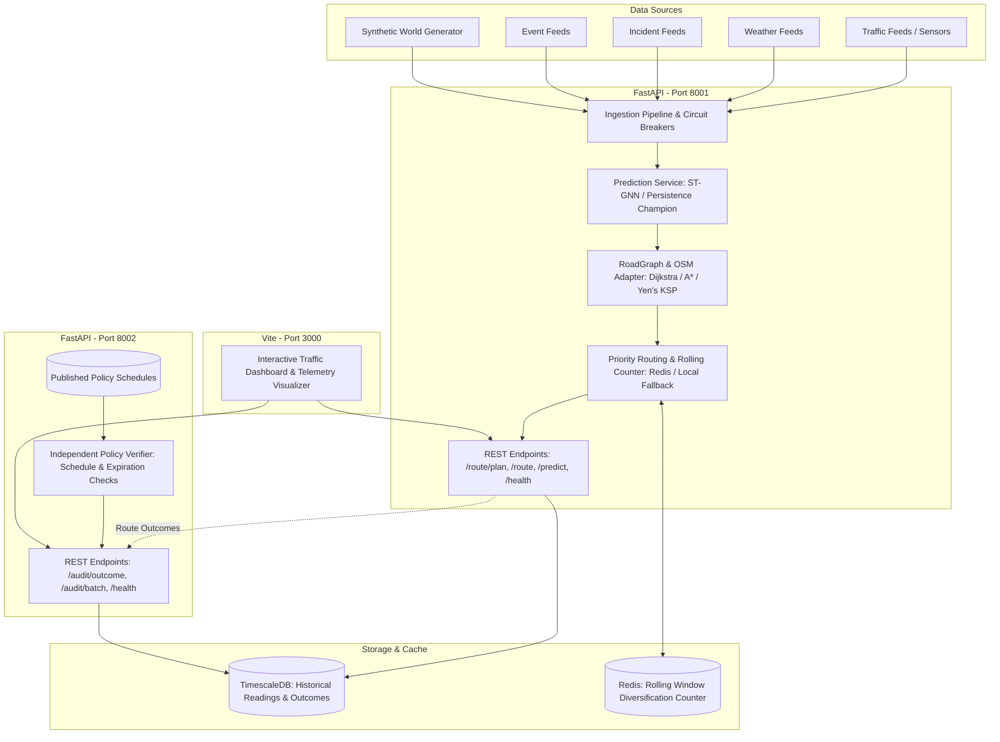

# CATRS System Architecture

## 1. High-Level Overview

The **Congestion-Aware Traffic Routing System (CATRS)** is a distributed, multi-modal traffic forecasting, routing, and independent policy audit platform. It optimizes urban mobility by combining real-time sensor observations, multi-horizon speed forecasting, graph-based routing with BPR congestion impedance, and rolling-window capacity diversification.

---

## 2. Component Architecture

### A. Routing Engine (`services/routing-engine`)
The core routing brain responsible for ingestion, speed prediction, graph pathfinding, and diversification:
1. **Feed Ingestion & Normalizer (`app/data/feeds`)**:
   - Resilient feed clients (`TrafficFeedClient`, `WeatherFeedClient`, etc.) equipped with `CircuitBreaker` (Closed, Open, Half-Open), bounded retries with exponential backoff, and deduplication.
   - Comprehensive provenance metadata on all observations: `source`, `ingested_at`, `confidence_score`, `is_synthetic`, and `units`.
   - Explicit identification of synthetic data; simulated traffic is never disguised as live telemetry.
2. **Prediction Subsystem (`app/models`)**:
   - Multi-horizon forecasting (5-minute, 15-minute, and 30-minute horizons).
   - Unified feature scaling: inputs normalized using training-set parameters, outputs inverse-transformed to physical speed units (mph / km/h).
   - Strict range bounds `[1.0, 150.0]` and NaN/Inf rejection.
   - Model release discipline: ST-GNN checkpoints are gated behind baseline evaluation. Validated Persistence baseline is the production champion.
3. **Road Network & Route Generation (`app/routing`)**:
   - `RoadGraph`: Topological road network representing directed segments, one-way restrictions, turn restrictions, road classes, speed limits, and segment capacities.
   - `OSMAdapter`: Ingestion of GeoJSON road features and real-world OpenStreetMap networks.
   - Pathfinding: Dijkstra and A* (using Haversine/Euclidean coordinate heuristics), with Yen's K-Shortest Paths algorithm for alternative route generation.
   - Congestion Travel Time: Bureau of Public Roads (BPR) function calculating non-linear travel time impedance under volume-to-capacity congestion:
     $$T = T_0 \cdot \left(1 + \alpha \cdot \left(\frac{V}{C}\right)^\beta\right)$$
4. **Diversification & Capacity Management (`app/routing/redis_counter.py`)**:
   - Atomic rolling-window assignment caps implemented via Redis Lua scripts.
   - Thread-safe sliding-window process-local fallback when Redis is unreachable, exposing degraded status and consistency warnings in route explanations.

### B. Independent Policy Audit Service (`services/audit-service`)
- Operates as a completely isolated microservice to eliminate conflict of interest.
- Validates routing outcomes against published JSON schema policy schedules.
- Verifies priority weight applications, trip category eligibility, schedule effective dates, and policy expiration dates.
- Does not trust assertions from the routing engine; audits raw inputs and recorded outcomes independently.

### C. TimescaleDB Persistence
- Hypertable storage for segment-level traffic readings, historical baselines, and audit results.
- Partitioned by observation timestamps with automated downsampling.
- Idempotent upsert operations preventing duplicate readings during sensor retries.

### D. Operator Dashboard (`frontend/`)
- Vite-based web console providing real-time telemetry, model prediction comparisons, road network pathfinding, and policy audit monitoring.
- Explicit visual badges distinguishing live sensor feeds from synthetic simulations.
- System operational health indicators (Healthy, Degraded, Unavailable).

---

## 3. Contract Boundaries and Data Flow

| Interface | Producer | Consumer | Protocol / Payload | Verification |
| :--- | :--- | :--- | :--- | :--- |
| **Route Request** | Client / Frontend | Routing Engine | `POST /route` / `POST /route/plan` | Pydantic strict model validation (`extra="forbid"`, finite floats) |
| **Speed Prediction** | Routing Engine | Internal / API | `POST /predict` | Range checks `[1.0, 150.0]`, NaN/Inf checks |
| **Route Outcome** | Routing Engine | Audit Service | `POST /audit/outcome` | Independent policy verifier, effective date & expiry validation |
| **Audit Batch** | Batch Job / Operator | Audit Service | `POST /audit/batch` | Version matching, trip category verification |
| **Health & Readiness**| Orchestrator / K8s | Both Services | `GET /health`, `GET /ready` | Deep dependency probes (TimescaleDB, Redis, Model Health) |

---

## 4. Failure Modes and Degradation Strategy

1. **Redis Cache Outage**:
   - The routing engine automatically switches to an in-memory thread-safe sliding window counter.
   - Routing continues without downtime.
   - Responses include `"is_degraded": true` and a consistency warning detailing process-local limitations.
2. **ST-GNN Checkpoint Failure or Invalid Outputs**:
   - Prediction service automatically falls back to the validated Persistence baseline or domain heuristic.
   - Model health status is reported as `heuristic_fallback`.
3. **Database Disconnection**:
   - In synthetic mode, memory repositories maintain continuity.
   - In production mode, `/ready` reports 503 while `/health?full=true` returns operational status `degraded`.
4. **External Feed Latency or Outage**:
   - `CircuitBreaker` trips after 5 consecutive failures, opening the circuit for 30 seconds before attempting half-open recovery.
   - Ingestion gracefully falls back to deterministic simulation, setting `is_synthetic=True`.
